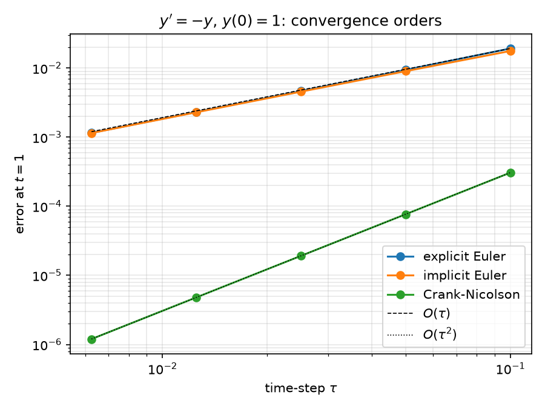
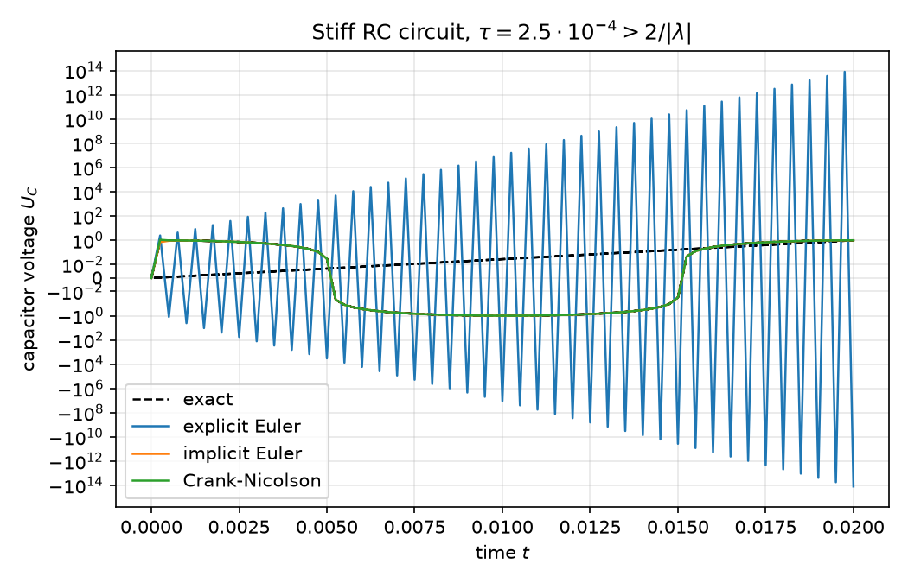

# Part 3: Numerical Methods for ODEs

TU Wien 360.242, winter semester 2026/2027

## Scope

Sections 14-17: theory of initial value problems, the explicit and implicit Euler methods, Crank-Nicolson, and their implementation in the `ASC-ODE` library.

## Implementation

`CrankNicolson` was added to `src/timestepper.hpp` using the existing function algebra. For one step it solves

$$
F(y) = y - y_{\text{old}} - \frac{\tau}{2}\big(f(y_{\text{old}}) + f(y)\big) = 0
$$

with Newton's method. The equation is built once in the constructor,

```cpp
m_equ = ynew - m_yold - m_tau * (0.5 * (m_fold + m_rhs));
```

and each step only updates the old state, the old right-hand side and the time-step. The Jacobian

$$
F'(y) = I - \frac{\tau}{2} f'(y)
$$

comes from the sum, product and chain rules of the algebra, so no derivative code is written by hand.

## Convergence

Test problem: `y' = -y`, `y(0) = 1`, exact `y(1) = e^{-1}`. The error at `t = 1` is measured for 10 to 160 steps, and the order follows from `p = log2(e(tau) / e(tau/2))`.

| Method | Measured order | Error at 160 steps |
|---|---|---|
| Explicit Euler | 1.00 | `1.153e-3` |
| Implicit Euler | 1.00 | `1.147e-3` |
| Crank-Nicolson | 2.00 | `1.198e-6` |



The measured orders match the theory: both Euler methods are first order, Crank-Nicolson is second order. The reference lines in the plot use the measured error of the coarsest step of each method.

## Stiff problem

RC circuit from section 16,

$$
U_C' = \frac{U_0(t) - U_C}{RC}, \qquad U_0(t) = \cos(100\pi t),
$$

with `R = 100`, `C = 1e-6`, so `lambda = -1/(RC) = -1e4`. The time is appended as a state, `z = (U_C, t)`, to obtain an autonomous right-hand side. Final time is `T = 0.02`, step size `tau = 2.5e-4`, above the explicit Euler stability limit `2/|lambda| = 2e-4`.

| Method | `U_C(T)` | Error |
|---|---|---|
| Explicit Euler | `-1.2229e14` | diverged |
| Implicit Euler | `0.99779` | `1.2e-3` |
| Crank-Nicolson | `0.99901` | `< 1e-5` |
| Exact | `0.99901` | |



Explicit Euler is unstable because `|1 + tau lambda| = 1.5 > 1`. The implicit methods remain stable and produce the correct solution. Crank-Nicolson shows a small undershoot during the initial fast transient, which is the expected consequence of A-stability without L-stability: `g(z) -> -1` for `|z| -> infinity`. Implicit Euler damps that mode because `g(z) -> 0`.

## Reproducibility

```sh
git submodule update --init
cmake -S . -B build -DCMAKE_BUILD_TYPE=Release
cmake --build build -j
./build/test_order
./build/test_stiff
```

The same build runs in the dev container with `devcontainer up --workspace-folder .`, which builds into `build/container`. `scripts/plot_order.py` and `scripts/plot_stiff.py` regenerate the figures from the CSV output.

